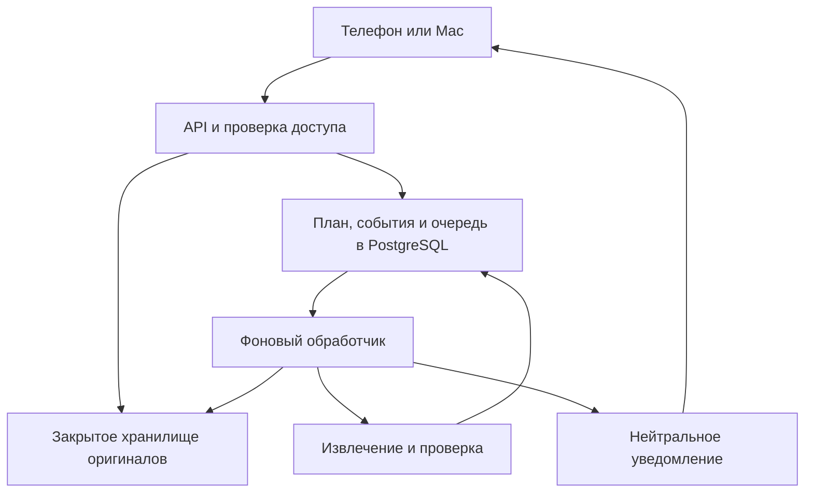

# Архитектура мобильного пилота

[План проекта](README.md) · [Поведение экранов](screens.md) · [Порядок реализации](delivery.md)

Это предлагаемая архитектура. Текущий скрипт macOS полезен для проверки самой привычки и доставки на одном устройстве. В мобильный пилот переносим сценарий и контрольные примеры. Доступ к заметкам Mac по умолчанию не запрашиваем. Публичный репозиторий содержит код, документацию и синтетические примеры. Сервер, домен, поставщик модели, хостинг и регион хранения для реальных данных пока не выбраны.

## Клиент, сервер и фоновые задачи

Один адаптивный веб-клиент с возможностью установки на домашний экран (PWA). Предлагаемый стек — TypeScript, React, серверное приложение на Node.js, PostgreSQL и закрытое объектное хранилище для оригиналов. Начинаем одним репозиторием, одним API и отдельным фоновым процессом из той же кодовой базы. Фоновые задачи и очередь исходящих событий храним в PostgreSQL. Это позволяет одному разработчику локально воспроизводить сохранение, расписание, отмену и повтор задания без отдельных сервисов для каждой темы.

| Часть системы | Контракт и граница ответственности |
|---|---|
| Клиент | Показывает серверную версию плана, позволяет проверить источник, хранит только необходимую сессию. Сервис-воркер кэширует оболочку, приватные ответы и документы исключены из кэша. Push содержит нейтральный текст и непрозрачную ссылку. После входа сервер проверяет доступ заново. |
| API и модуль плана | Аутентификация, проверка владельца, обработка команд, версии записей, согласия, экспорт. Только этот модуль принимает изменение плана. Клиент и модель не пишут в таблицы плана напрямую. |
| Фоновый процесс | Забирает задания с ограниченным сроком захвата, разбирает файл или готовит контакт. После сбоя захват истекает, задачу можно повторить. Повтор не создаёт второй факт, действие или входящий вопрос. |
| Модуль знаний и ИИ | Читает минимально необходимый контекст одной учётной записи, выдаёт типизированные предложения с основаниями. Правила допуска и проверка источника выполняются независимо от генерации текста. Допускается ответ «недостаточно сведений». |
| Уведомления | В базе сначала появляется доступный из «Сегодня» вопрос. Push — средство позвать к нему. На старте выбирается одно основное устройство для внешнего контакта; на других актуальный вопрос виден при входе. |
| Эксплуатация | Отдельные среды демонстрации, тестирования и пилота. Обезличенные технические события, доступ к сбоям по коду причины, выключатели внешних отправок и обработки моделью. Ручной просмотр медицинского материала — только по определённой роли, основанию и с записью доступа. |

**Почему проверяем телефон в самом начале.** WebKit описывает Web Push для веб-приложений, добавленных на домашний экран iOS, и запрос разрешения после прямого действия человека. Поэтому «разрешить уведомления» появляется после выбора срока. На реальном iPhone проверяем установку, системный запрос, закрытый клиент, режим фокусирования, переход после входа и отзыв разрешения. При недоступном канале честно показываем «вопрос появится в приложении». Если люди не проходят этот шаг или канал ненадёжен, пробуем согласованный альтернативный канал либо тонкий нативный клиент, сохраняя серверный план. [WebKit](https://webkit.org/blog/13878/web-push-for-web-apps-on-ios-and-ipados/) · [Протокол Web Push](https://www.rfc-editor.org/rfc/rfc8030)

## Модель данных

Все пользовательские сущности привязаны к владельцу. Для времени различаем дату события, время внесения, точность известной даты и зону контакта. Общие клинические источники версионируются независимо. Медицинская запись из ноября, загруженная в марте, не превращается в мартовское измерение.

| Сущность | Минимум данных | Смысл связи |
|---|---|---|
| Account, Device, Consent | Идентификатор, сессия, локаль, часовой пояс IANA, основной канал, область и версия согласия, время отзыва | Отдельные разрешения на внешнюю связь, передачу материалов обработчику и доступ человека. Покупка тарифа их не подменяет. |
| Topic | Слова пользователя, цель, статус, дата обновления, владелец следующего действия | Одна учётная запись ведёт несколько тем. Один проверенный факт может относиться к нескольким темам. |
| Source, Evidence | Тип источника, закрытый ключ объекта, отпечаток внутри профиля, дата, страница и фрагмент; для сообщения — идентификатор и цитата | Первичный материал отделён от извлечённых значений. Можно вернуться к конкретной фразе, в том числе после повторного разбора. |
| Observation | Тип, исходный текст, дата события, значение и единица при наличии, статус проверки, ссылки на Evidence, предыдущая версия | Ответ пользователя, измерение и запись врача имеют разное происхождение. Уточнение создаёт версию и помечает зависимые выводы к пересмотру. |
| Proposal, PlanItem | Что предлагается, основания, тип действия, срок из источника, добровольный срок контакта, согласие, версия, ответственный | Черновик предложения может быть отклонён. Только согласованное действие порождает расписание. |
| Contact, Inbox, DeliveryAttempt | Идентификатор одного повода, версия действия, локальные дата/время и зона, вычисленное UTC, статус ответа, канал, срок годности отправки | Запланированный контакт, доступный пользователю вопрос и техническая попытка доставки — разные записи. |
| RuleVersion, Review | Источник и версия рекомендации, целевая группа, исключения, минимальные входные сведения, рецензент, дата пересмотра | Для вывода можно восстановить, что именно применили и когда. Отзыв правила выключает его применение. |
| Change, Job, Entitlement | Версия изменения и основание, ключ повторной операции, число попыток и время следующей, право на сервис до даты | По ним воспроизводим изменения, учитываем повторные события оплаты и останавливаем будущие контакты при завершении периода. |

Проверяемые инварианты: факт имеет владельца и источник, поручение имеет версию и ответственного, у актуального вопроса один идентификатор, документ одного аккаунта не может обосновать вывод другого. После удаления персонального материала сохраняются только минимальные технические следы в пределах принятой политики. Для будущего обмена с клиниками маппинг на FHIR планируем на границе экспорта; внутри пилота достаточно перечисленных связей. [HL7 FHIR Provenance](https://hl7.org/fhir/R4/provenance.html)

## Команды и жизненный цикл

Предлагаемые контракты для реализации. Текущих доступных сетевых методов в пилоте Mac нет.

| Команда | Что принимает и возвращает | Правило |
|---|---|---|
| POST /messages | Текст, clientRequestId, необязательная тема → сообщение и proposalId либо один вопрос | Повтор запроса с тем же ключом возвращает исходный результат. Перед долгой обработкой подтверждаем приём отдельно. |
| POST /proposals/{id}/accept | Исправленный вопрос, владелец, срок, зона, канал, ожидаемая версия → planItemId и следующий контакт | Предложение, новое действие и запись в очереди связываются в одной транзакции. |
| GET /today и GET /topics/{id} | Версия плана, время актуальности, очередь, следующий срок, источники | Один и тот же источник данных для трёх вкладок и обоих устройств. |
| POST /contacts/{id}/responses | Ответ, перенос или остановка, ключ запроса, ожидаемая версия → итог и актуальный план | Запоздалый ответ не возобновляет закрытый контакт. При конфликте клиент получает свежую версию и выбор, как сохранить новый контекст. |
| POST /sources и подтверждение загрузки | Тип, размер, отпечаток → короткоживущий доступ к закрытому объекту → статус обработки | Ограничиваем формат и размер, валидируем содержимое. Повтор задания и повторный файл одного владельца распознаются отдельно. Незавершённый объект истекает. |
| POST /observations/{id}/corrections | Новое значение, причина, версия → обновлённый факт и затронутые предложения | Пересчитываем только зависимые темы. Историческую формулировку и дату можно проверить до удаления источника. |
| POST /exports и DELETE /account | Объём выгрузки или подтверждённый запрос удаления → состояние операции | Повтор безопасен. Сразу блокируем будущие отправки, завершаем удаление из рабочих систем и учитываем срок истечения резервных копий. |

**Состояния поручения.** Предложено → согласовано → ждёт срока → ждёт ответа → результат учтён. Дополнительные переходы — отклонено, перенесено, на паузе, закрыто. Перенос увеличивает версию и заменяет будущий контакт. Закрытие из любой активной стадии отменяет будущие задания. Ответ без договорённости о продолжении завершает цикл. Отправка push сама по себе не закрывает ни одно действие.

**Как дойдёт инициативный вопрос.** При подтверждении сохраняем план и задание в одной транзакции. В срок обработчик повторно проверяет статус, версию, канал, согласие, доступ к сопровождению и тихие часы. Создаёт один входящий вопрос с уникальным ключом «поручение + версия + запланированное наступление», затем пытается отправить его во внешний канал. Перед повтором проверяет те же условия. Временные сбои повторяем ограниченно с увеличением задержки до истечения срока. Отзыв подписки устройства прекращает попытки. Принятие сообщения провайдером, открытие и ответ измеряем отдельно. При сетевом сбое после принятия провайдером абсолютная гарантия единственного баннера недостижима; используем один идентификатор уведомления и одну запись во входящих. При гонке с закрытием устаревшая ссылка ведёт к обновлённой теме.

**Время и два устройства.** Запоминаем, что значило «в пятницу в семь» в согласованной зоне. При смене зоны спрашиваем, оставить ли исходное местное время или перенести договорённость. Для неоднозначного или отсутствующего времени при переводе часов показываем конкретный рассчитанный момент до подтверждения. Открытие на Mac после ответа с телефона читает новую версию. Параллельное исправление не затирает первое молча.

## Как ИИ собирает общую картину

1. **Разобрать материал.** Сначала извлекаем текст PDF; при необходимости запускаем OCR. Сохраняем страницу, координаты/фрагмент, исходную единицу, дату и тип источника. Текст документа считается недоверенными данными. При сомнении в принадлежности, качестве страницы или смысле запись уходит на уточнение.
2. **Предложить факты.** Модель возвращает поля по схеме, фрагменты и пропуски. Проверки убеждаются, что цитата существует на указанной странице, число и единица согласованы с оригиналом, а отсутствующая дата осталась пустой. Плохую читаемость показываем отдельно от медицинской неопределённости.
3. **Сопоставить темы.** Один факт может поддержать несколько тем. Сопоставляем по типу, времени, источнику и подтверждённым ссылкам. При противоречии храним обе записи; более новая дата загрузки сама по себе не делает запись верной. При исправлении задаём пересмотр только зависимых действий.
4. **Сформировать следующий шаг.** Очерёдность: уже согласованный срок, явно указанное открытое поручение, затем уточнение, меняющее применимость проверенного правила. Для вопроса должны существовать как минимум два разных продолжения в зависимости от ответа. Спрашиваем самый дешёвый для человека доступный факт. Пропуск оставляет явную неопределённость.
5. **Объяснить и обновить.** Возвращаем пользователю краткую формулировку, основания, границу уверенности, что изменится при ответе и кто решает дальше. Клинические рекомендации для профилактики попадают в систему через версионированный каталог, проверку врачом и ограниченный выпуск. Новый текст книги или согласие нескольких моделей не переводят гипотезу в подтверждённый вывод.

**Что означает «команда специалистов» технически.** В пилоте есть четыре проверяемые роли: извлечение, сопоставление истории, проверка основания и координация действий. Одну модель можно использовать для нескольких ролей. У каждой собственный формат результата и набор контрольных примеров. Если позже потребуется специализированный модуль, он отдаёт предложения тому же координатору с источником и границами применимости. При разногласии в интерфейсе остаётся открытый вопрос. Перед добавлением нового модуля измеряем прирост качества, задержку и стоимость на той же выборке.

## Реальные данные, эксплуатация и выход из пилота

**Следующий источник динамики.** После пилота выбрать одну интеграцию по потере времени на ручной ввод. Адаптер устройства обязан передавать источник, идентификатор исходной записи, тип, единицу, время наблюдения и временную зону. Курсор синхронизации двигается только после успешного сохранения порции. Повторная выгрузка обновляет ту же запись. Перекрывающиеся данные двух источников сохраняют своё происхождение, механизм сравнения не удваивает наблюдение. При разрыве связи пользователь видит дату последней синхронизации, выбор восстановить связь, ответить вручную или приостановить тему. До выбора устройства проверяем реальный доступ к API, согласие, регион, стоимость и правила использования данных.

**Подписка и данные.** У сопровождения есть состояния «проба», «активно», «отменено до конца периода» и «период истёк». Отмена автопродления сохраняет оплаченный срок. Пауза контактов по желанию человека действует сразу. В момент окончания прекращаем новые исходящие контакты и пересмотр плана, открытые дела показываем со временем последнего обновления. Повторная оплата предлагает проверить старые договорённости до возобновления отправок. Доступ к экспорту, срок хранения и удаление задаются отдельно от права на сопровождение.

- **Доступ и хранение.** Короткоживущая ссылка на оригинал выдаётся после проверки владельца; загрузка сначала попадает в изолированную зону обработки. Отдельные права API, обработчика и рецензента, TLS, шифрование хранилищ и резервных копий, секреты вне Git. На каждой таблице пользовательских данных проверяем область владельца, дополнительно проектируем политики PostgreSQL и тест двух разных аккаунтов. Владелец таблиц и роль приложения разделены. [Документация PostgreSQL](https://www.postgresql.org/docs/current/ddl-rowsecurity.html)
- **Граница внешней обработки.** До собственных реальных выписок зафиксировать страну хранения, перечень получателей, режим обучения/хранения у поставщика, условия удаления и отзыва. Если это ещё не решено, технический цикл проверяется на синтетических материалах. Голосовая запись требует отдельного решения о передаче и сроке удаления сырого аудио.
- **Правовая и клиническая проверка.** До пилота с другими людьми в выбранной стране согласовать с профильным юристом основания обработки, локализацию, трансграничную передачу, обязанности оператора и статус конкретных профилактических функций. Для первой клинической темы найти рецензента и подписать перечень допустимых выходов. Обещание назначения лечения изменит эти границы и потребует отдельного решения.
- **Управление жизненным циклом.** До запуска указать конкретные сроки хранения оригиналов, производных записей, временных файлов, экспортов, технических журналов и резервных копий. Пройти тест удаления и восстановления с повторным применением списка удалений. Удаление источника отзывает основанные только на нём выводы и отправки; для общих фактов пересматриваем оставшиеся основания.
- **Контроль выпуска.** Синтетический набор проходит на каждой версии схемы, модели, промпта и правил. В событиях аналитики только идентификатор события, версия и код результата; тексты, названия файлов, показатели и содержимое пушей исключены. На панели отслеживаем задержку очереди, необработанные ошибки, стоимость OCR/модели и долю контактов без ответа. При опасной ошибке выключаем затронутую функцию, помечаем выводы на пересмотр и проверяем круг затронутых записей. Вход, история и выгрузка должны оставаться доступными.
