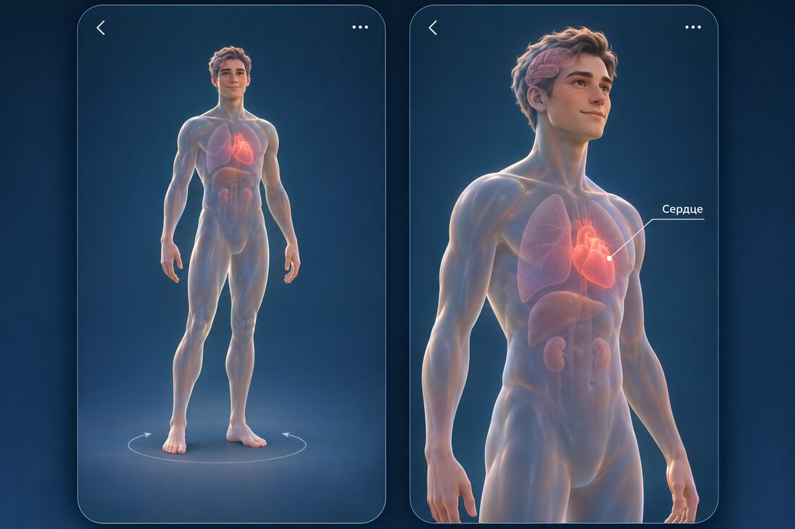

# «Это ты». Техническое задание на интерактивную 3D-карту тела для iPhone

## Задача для художника

Создать стилизованную анатомическую модель взрослого человека для вертикального экрана iPhone. Пользователь поворачивает фигуру пальцем, приближает интересующую область и касается органа, чтобы открыть связанные с ним документы. Качество визуала оцениваем на размере телефона. Это общая навигационная фигура для всех пользователей. Внешность и медицинские данные конкретного человека художнику не передаются.

**Первая поставка — цельный персонаж с головы до пят.** В первом кадре одновременно видны макушка, кисти и обе стопы. Внутри — сердце, печень и две почки отдельными объектами. Лёгкие и мозг на референсе задают второй план. Запросите отдельную смету на их детализацию. Для оценки пришлите общий вид, поворот и крупный план после выбора сердца, срок первого мобильного экспорта, цену и условия передачи исходников.

## Художественное направление

- По ощущению это персонаж редактора внешности в симуляторе жизни. Оригинальные лицо, пропорции и пластика. Естественная расслабленная поза, руки слегка отведены, силуэт хорошо читается при повороте. Игровые ассеты и фирменную символику других продуктов не использовать.
- Цельная полупрозрачная оболочка покрывает грудь и живот. Лицо, волосы, кисти и ступни сохраняют читаемую форму. Внутренние органы видны сквозь поверхность спереди и сзади. Степень прозрачности можно менять в приложении.
- В обычном состоянии органы приглушены. При касании только выбранный орган становится ярче: сердце — кораллово-красное, для остальных подбирается собственный оттенок. Подсветка и подпись означают выбор. Даты и наличие документов показывает карточка.
- Общий вид — спокойный тёмно-синий фон, мягкая световая кромка на силуэте, свободное место у головы и под стопами. Проверить читаемость в светлой теме. Художник сдаёт два кадра одной сцены: полный рост и приближение к выбранному сердцу. Референс задаёт художественное направление; форму органов проверяют по анатомической геометрии.

## Как модель будет двигаться

| Действие пользователя | Что делает приложение | Что подготовить в модели |
| --- | --- | --- |
| Ведёт одним пальцем в сторону | Вращает фигуру по горизонтали на 360°, сохраняя высоту камеры | Единый корневой узел с центром на оси позвоночника, готовые виды спереди, сбоку и сзади |
| Разводит два пальца | Плавно приближает выбранную область или отдаляет до фигуры в полный рост | Читаемые формы и материалы вблизи, без растянутых текстур |
| Касается сердца или печени | Выделяет орган и показывает карточку с названием и материалами | Отдельный узел видимой геометрии и упрощённая область касания |
| Касается любой почки | Открывает общую карточку «Почки», выделяет обе почки | Два именованных узла и две области касания |
| Закрывает карточку или нажимает «Вид спереди» | Закрытие сохраняет угол и масштаб. Сброс возвращает к начальному виду | Фронтальный ракурс в полный рост с запасом сверху и снизу |

Управление камерой, жесты, подсветку, привязку к документам и доступный текстовый список органов реализует разработчик iOS. Модель сдаётся без программной логики. Привязка пальца к жесту вращения должна отличаться от короткого касания органа.

## Файлы и контракт с iOS

1. Редактируемый исходник `.blend` со всеми используемыми ресурсами, отдельными объектами и применёнными преобразованиями.
2. Основная поставка `BodyMap.usdz` для RealityKit. В одном файле полный персонаж и внутренние органы, материалы встроены. Также `BodyMap.glb` для быстрой проверки вне Xcode и четыре PNG-ракурса. Единицы — метры, ось вверх в экспортированном USD — Y. В исходнике указать рост фигуры и направление фронта.
3. Стабильные имена узлов: `body_root`, `body_shell`, `heart`, `liver`, `kidney_left`, `kidney_right`. Области касания: `hit_heart`, `hit_liver`, `hit_kidney_left`, `hit_kidney_right`. Оболочка не перехватывает попадания по органам. Для почек в приложении используется одна область `kidneys`.
4. Экспортировать стандартные PBR-материалы. Процедурные материалы Blender запечь. Предварительный бюджет — до 60 000 треугольников, до восьми материалов, текстуры до 2048 px, USDZ до 12 МБ. Это ориентиры для пилота. Исключения согласуем по замеру на телефоне.
5. Передать список исходников, авторов, точных версий, ссылок, лицензий и изменений. Для заказной геометрии и текстур согласовать коммерческое использование, право модификации, распространение внутри приложения и передачу исходников. Если в сцене сторонняя геометрия, каждый объект должен иметь установленное происхождение.

## Готовая база для оценки

Вместо моделирования всех органов с нуля можно взять геометрию сердца, печени и почек из официального архива **BodyParts3D**, упростить сетку и сделать согласованные материалы. На первом этапе попросить художника показать один обработанный орган рядом с оригиналом. Скачивать из архива с сохранением README и лицензии именно полученных файлов. На странице лицензии архива указана CC BY 4.0 и приведена атрибуция: «BodyParts3D, © The Database Center for Life Science licensed under CC Attribution 4.0 International». В ведомости отметить упрощение, изменение цвета и экспорт. [Скачать данные](https://dbarchive.biosciencedbc.jp/en/bodyparts3d/download.html) · [Условия архива](https://dbarchive.biosciencedbc.jp/en/bodyparts3d/lic.html)

Альтернатива — авторская модель всего персонажа и органов в Blender по анатомическим референсам. Генерацию изображений можно использовать для согласования силуэта, освещения и материалов. Достаточность геометрии для 360° и выбора органов проверяется на экспортированной сцене. [Поддержка форматов RealityKit](https://developer.apple.com/documentation/realitykit/entity/load(named:in:))

## Приёмка первой поставки

- На телефоне открыть USDZ: в портретном режиме видны макушка и обе стопы. Осмотреть фигуру спереди, в три четверти и сзади. Обе почки на месте, органы не исчезают при вращении, у оболочки нет неожиданных отверстий и мерцания.
- В тестовом iOS-экране повернуть модель на полный оборот, приблизить каждый орган и по три раза выбрать его с двух ракурсов. Сверить идентификатор карточки. Проверить пересечения областей касания у границ.
- Запустить сцену без сети, в светлой и тёмной теме. Предлагаемая цель на самом старом доступном тестовом iPhone — не меньше 30 кадров/с при вращении в течение 20 секунд. Зафиксировать модель устройства, размер файла и фактическую частоту.
- Проверить открытие карточки из списка VoiceOver и возврат на исходный ракурс. Показать 15-секундную запись экрана с настоящего телефона. Итог поставки — исходники, экспортированные файлы и список привлечённых ресурсов.

## Сообщение для первого контакта

> Нужен цельный полупрозрачный 3D-персонаж с головы до пят для iPhone, с ощущением редактора персонажа в симуляторе жизни. Пальцем вращаешь фигуру, двумя пальцами приближаешь и отдаляешь. При касании орган загорается, а приложение открывает его карточку. Для первой поставки нужны вся фигура, сердце, печень и две почки отдельными объектами. Пришлите примеры мобильных персонажей, стоимость и сроки, вариант прав на исходники, сможете ли сдать Blender и USDZ. Код приложения делаем сами.
