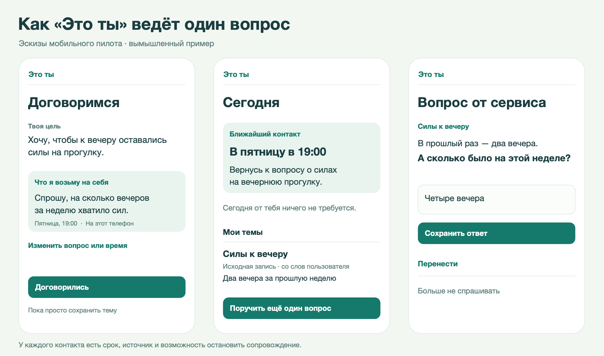
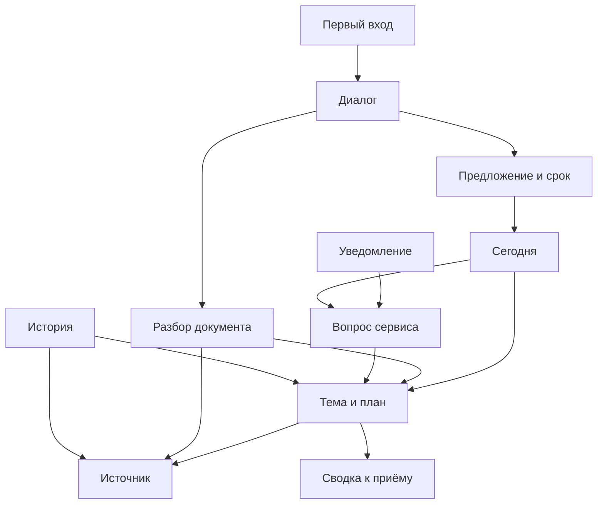

# Экраны и поведение

[План проекта](README.md)

На телефоне три постоянные вкладки: **Сегодня**, **Диалог**, **История**. Сегодня отвечает на вопрос «Что поручено и когда я понадоблюсь?». Диалог принимает свободный ввод. История позволяет найти источник и понять, почему изменился план. Темы открываются из «Сегодня», документ — из диалога, истории или конкретного факта. Настройки доступны с «Сегодня». На большом экране те же адреса и значения, детали можно показать справа. Идентификатор в ссылке не раскрывает тему.

## Карта переходов

## Спецификация экранов

A — первый работающий цикл, B — документы и сводка, C — один рецензированный сценарий профилактики. Идентификаторы используются в очереди разработки и приёмке. Регистрацию и восстановление учитываем в маршруте, даже если первые показы проходят на синтетическом профиле.

| Экран | Что сверху вниз на телефоне | Основное действие и куда ведёт | Если что-то пошло иначе |
|---|---|---|---|
| S01 · Первый вход и доступ · A | Одно предложение о сервисе, поле «Что взять на себя?», вторичный вход для вернувшихся. До создания аккаунта — локальное демо с вымышленной историей. Для сохранения — вход и краткое объяснение, где будут данные | «Начать» → S03. Дать попробовать текст, позже предложить сохранить договорённость | «Пока не знаю» открывает два примера или пустое «Сегодня». Незавершённая авторизация не создаёт расписание. По ссылке из пуша после входа открывается тот же вопрос, если он ещё активен |
| S02 · Сегодня · A | Сначала одно дело, требующее участия прямо сейчас. Затем ближайший контакт с датой и каналом. Ниже темы с последним источником. Кнопка «Поручить вопрос», вход в настройки | Ответить → S05, открыть тему → S06, начать новую → S03 | В пустом профиле одна точка входа. В спокойный день «Сегодня от тебя ничего не требуется» с датой следующего контакта. Если внешняя связь выключена, сообщить, что вопрос появится внутри |
| S03 · Диалог · A/B | История разговора, одно короткое уточнение, поле ввода, затем фото/PDF в B. Сохранённые факты и предложенные действия различимы прямо в ленте | Из свободной фразы показать редактируемое предложение → S04. Из файла → S07. Пользователь может ответить диктовкой клавиатуры | Кнопки «Пропустить» и «Зачем спрашиваете?». При таймауте модели оставить введённый текст и предложить вручную сохранить тему. Повторная отправка одной фразы после обрыва не создаёт второе поручение |
| S04 · Подтвердить договорённость · A | Название темы, что берёт сервис, какой вопрос задаст, когда по местному времени, по какому каналу, что потребуется от человека | «Договорились» → S02 с карточкой ближайшего контакта. «Изменить» оставляет текст редактируемым | Неизвестный срок из выписки так и обозначается. Время добровольного напоминания указывается отдельно. Отказ от внешних уведомлений оставляет канал «только в приложении» |
| S05 · Вопрос сервиса · A | Договорённость, прошлый ответ с датой, один сегодняшний вопрос, ответ в одну строку. Внизу «Перенести», «Больше не спрашивать» | После ответа показать, что изменилось и есть ли новый срок → S06. Для нового контакта требуется прежнее согласие на серию или новое подтверждение | По устаревшей ссылке показать «Вопрос уже закрыт/перенесён» и актуальную тему. На втором устройстве повторный ответ не дублируется. Пропуск не трактуется как плохое самочувствие |
| S06 · Тема и план · A/B/C | Что человек поручил, состояние сопровождения, следующий шаг и его ответственный, затем «Что известно», «Что изменилось», «Чего пока не знаем». У каждого факта источник и дата | Переход к источнику S07, редактирование договорённости S04, завершение или пауза. В B — подготовить сводку S09 | При конфликте показываем обе записи и предлагаем уточнить. При потере источника видна последняя дата. Закрытую тему можно открыть заново с новой договорённостью |
| S07 · Материал и проверка · B | Тип, дата документа, оригинал со страницей, выдержка рядом с распознанным полем. Явная метка «Нужно уточнить». Внизу будущие изменения плана | «Подтвердить» или исправить поле → обновлённая S06. Единым действием подтверждаются только хорошо читаемые и однозначные поля | Плохое фото — можно переснять, ввести только спорное место или отложить. Дубликат ведёт к ранее принятой версии. Документ другого человека не попадает в профиль |
| S08 · История · A/B | Датированная лента. По каждому событию различимы дата самого события и дата загрузки. В B — фильтры по теме и типу, поиск документа | Открыть событие → S06 или S07, вернуться к старой версии плана | При нуле записей вход в диалог. После исправления видна связь между версиями. Удалённый источник больше не открывается |
| S09 · К приёму · B | Выбранный период, цель визита, проверенные факты с датами, действующие поручения в исходной формулировке и вопросы. Предпросмотр одной страницы | Выбрать пункты → сохранить локальную копию или показать с экрана. Отправку врачу инициирует сам пользователь | При недостатке данных допускается сводка из одного вопроса. ИИ-гипотеза не становится фактом в экспорте. До сохранения видно, какие данные войдут |
| S10 · Настройки, доступ и данные · A/B | Устройство и канал связи, тихие часы, часовой пояс, разрешения, сессии. В B — экспорт, удаление, обработчики файлов. Позже — тариф с датой окончания | «Проверить связь», «Пауза», выгрузить, отозвать согласие, удалить с отдельным подтверждением. После изменения виден эффект на ближайший контакт | При недоступном push предлагаем проверить канал. Окончание подписки сохраняет доступ к выгрузке и открытым делам в пределах объявленной политики хранения. По запросу на удаление показываем ход и срок |
| S11 · Профилактика внутри темы · C | По какому вопросу проверяется применимость, какие признаки уже известны, что изменит одно уточнение, источник и дата рекомендации, что можно вынести на обсуждение с врачом | Ответить, приложить имеющийся источник или отложить → S06 с объяснением изменения | При отсутствии рецензированного правила или конфликте вывод остаётся открытым. Фраза «данных нет» не порождает список покупок |

## Три ключевых разговора

**Начало с одной фразы.** Человек пишет «К вечеру часто не остаётся сил на то, что я планировал». Сервис отвечает «Что удобнее отслеживать — сколько вечеров за неделю у тебя хватало сил, или хочешь сформулировать свой вопрос?» После выбора: «Сколько таких вечеров было за прошлую неделю? Можно пропустить». Карточка предлагает пятницу и время, даёт их изменить. Пользователь может поручить только один контакт. Для неопределённого ответа предусмотрен выход «Сохранить тему и вернуться позже» без внешнего сообщения.

**Инициатива через неделю.** На экране блокировки нейтральное «Это ты · есть запланированный вопрос». После входа: «В прошлый раз ты назвал два вечера. А сколько было на этой неделе?» После «четыре» человек видит обе записи, может добавить контекст, завершить наблюдение или договориться ещё на неделю. Если ответа нет, вопрос остаётся на «Сегодня». Ежедневных догоняющих сообщений по умолчанию нет.

**Две темы и один документ.** Вымышленная выписка содержит поручение принести дневник и отдельно упоминает запись о сне. Сервис предлагает две связи с одной страницей. Пользователь подтверждает только поручение, а неоднозначную запись оставляет открытой. Следующая выписка явно говорит «дневник просмотрен» — в истории появляется предложение закрыть именно это поручение. Вторая тема остаётся доступна с прежней историей. Врачебный срок и договорённое время следующего контакта имеют разные подписи и поля.

## Решения по взаимодействию

- При нескольких одновременных делах сначала уже согласованное на сегодня, затем действие с известным сроком, затем необязательное уточнение. Равные по приоритету дела сортируем по сроку. Исключительный сценарий просьбы о срочной помощи прерывает обычный разговор и следует отдельному, проверенному для региона тексту. Очередь сервиса не обеспечивает срочной связи.
- Ограничение продукта для пилота — одно необязательное инициативное обращение в согласованное окно. Изменившееся поручение, молчание человека или покупка подписки не дают автоматического согласия усилить частоту. Контакты можно объединить в один входящий элемент со списком.
- Важные состояния имеют текст и доступны без различения цветов. Проверяем основной путь с крупным системным шрифтом, клавиатурой и VoiceOver. Длинное сообщение, пустой ответ и недоступность микрофона не блокируют текстовый ввод.
- Во всех трёх вкладках данные берутся из одной версии плана. После нескольких дней без связи экран показывает дату последнего обновления. На первом этапе чувствительные данные не сохраняем для полноценной офлайн-работы на общем устройстве.
